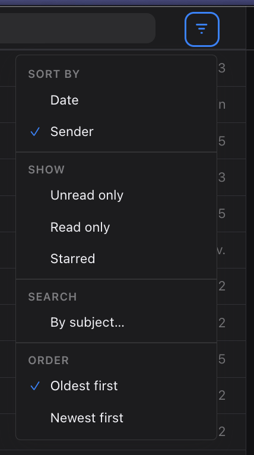

# Mailspring Sort Inbox

A Mailspring plugin that adds an Airmail-style **Sort & Filter** menu to the thread list toolbar, next to the search bar. Sort the inbox by date or sender, show only unread, read, or starred threads, and switch between oldest and newest first.



## Features

- **Sort by** Date (default) or Sender. Sender sorting matches the From column.
- **Order**: Newest first (default) or Oldest first.
- **Show**: Unread only, Read only, Starred. Filters combine, for example `is:unread is:starred`.
- **Clear filters** resets the filters and the search bar.
- **Search → By subject…** puts `subject:` in the search bar.

The button shows a dot when a non-default sort or filter is active.

## Languages

The menu follows Mailspring's language setting. It ships translations for French, Spanish, German, Italian, and Brazilian Portuguese (`lang/*.json`). Labels that Mailspring already translates, such as Date, Show, Unread, and Starred, use Mailspring's own translations. Everything else falls back to English.

To test a language without changing your settings, start Mailspring with `--lang`:

```bash
/Applications/Mailspring.app/Contents/MacOS/Mailspring --lang=de
```

To add a language, copy `lang/fr.json` to `lang/<code>.json` (for example `lang/nl.json`) and translate the values. Keep the English keys as they are. `npm test` fails if a file is missing a key.

## Requirements

- Mailspring 1.6.3 or newer (from `engines` in `package.json`). Tested on Mailspring 1.26.0.
- This plugin patches Mailspring internals (`query.js`, `query-subscription.js`, `search-query-subscription.js`, `thread-list-store.js`). A Mailspring update can break it, so check it after upgrading.

## Install

### From a release (recommended)

1. Download `mailspring-sort-inbox-<version>.zip` from the [Releases](https://github.com/saint-james-fr/mailspring-sort-inbox/releases) page.
2. Extract the zip.
3. In Mailspring, choose **Developer > Install a Plugin...** and select the extracted `mailspring-sort-inbox` folder.
4. Restart Mailspring.

### From source

```bash
git clone https://github.com/saint-james-fr/mailspring-sort-inbox.git
```

Then install the cloned folder the same way (**Developer > Install a Plugin...**). You can also symlink it into your Mailspring packages folder:

- macOS: `~/Library/Application Support/Mailspring/packages`
- Windows and Linux: the matching path under your Mailspring config directory

Reload Mailspring after changing `lib/` or the styles.

## Development

```bash
npm install
npm run build          # compile src/ into lib/
npm run watch          # rebuild on change
npm test               # unit tests for search query helpers
npm run package-release  # build the release zip into the repo root
```

The build wipes `lib/` first and must emit `lib/main.js` at the package root, because Mailspring loads `"main": "./lib/main"`.

### Files

| File | Role |
|------|------|
| `src/main.js` | Registers the toolbar button and activates the store and hook |
| `src/sort-store.js` | UI state, localStorage, submits search queries, reloads the list |
| `src/sort-search.js` | Pure helpers for search query strings (unit-tested) |
| `src/thread-list-sort-hook.js` | Patches core queries so ORDER BY matches the menu |
| `src/airmail-sort-button.jsx` | Dropdown UI |

### How sorting works

Mailspring orders the thread list in SQLite through `ModelQuery`, not by re-sorting React rows. Read and starred filters are sent as search tokens (`is:unread`, `is:starred`). List sorting is applied in `thread-list-sort-hook.js`.

Sender sort uses a custom attribute, `__sortInboxListSender`, whose `orderBySQL()` runs a subquery on `Message` that mirrors Mailspring's participants column. Do not sort by `Thread.lastMessageReceivedTimestamp` as a stand-in. That enables Mailspring's ThreadCategory subselect and breaks the query.

### Manual check

1. Open the menu, choose **Sender**. The list follows the From column. Choose **Date** to go back.
2. Choose **Unread only**. Only unread threads show. Toggle it off to get the full list back.
3. Choose **Starred** with **Unread only** on. Both tokens apply.
4. Choose **By subject…**. The search bar gets `subject:` and the sender sort stays.

## Credits

Started from [Foundry376/Mailspring-Plugin-Starter](https://github.com/Foundry376/Mailspring-Plugin-Starter).

## Related projects

- [Foundry376/Mailspring](https://github.com/Foundry376/Mailspring): the Mailspring app itself
- [jvsteiner/jev-mailspring](https://github.com/jvsteiner/jev-mailspring): AI-assisted inbox sorting for Mailspring
- [Wa-dot/mailspring-sort](https://github.com/Wa-dot/mailspring-sort): another Mailspring sort plugin
- [rocket6317/mailspring-customizations](https://github.com/rocket6317/mailspring-customizations): macOS-focused theme and plugins
- [Striffly/mailspring-avatars](https://github.com/Striffly/mailspring-avatars): avatars in the message list
- [tennox/mailspring-categories](https://github.com/tennox/mailspring-categories): category tabs
- [visorcraft/mailspring_inbox_rightclick](https://github.com/visorcraft/mailspring_inbox_rightclick): right-click menu for inboxes

## License

[MIT](LICENSE)
